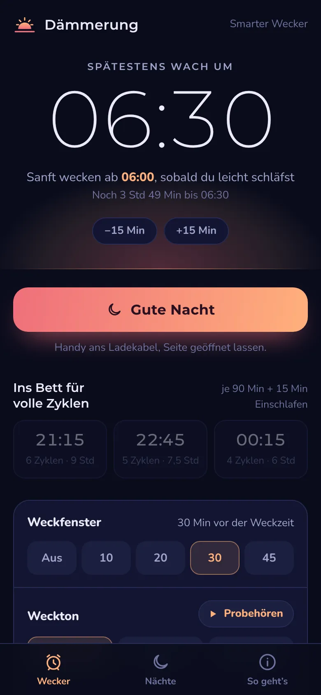
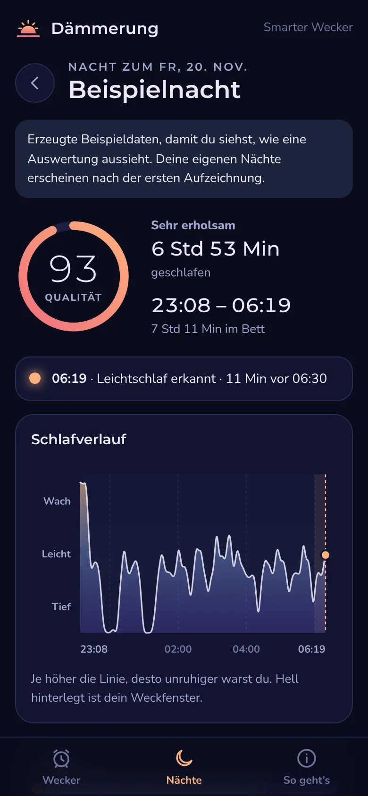

# Dämmerung – Smart-Wecker

Ein smarter Wecker als Web-App. Er weckt dich nicht stur zu einer Uhrzeit, sondern innerhalb eines Weckfensters genau dann, wenn du leicht schläfst. Er läuft komplett im Browser, lässt sich wie eine App installieren und braucht weder Konto noch Cloud.

**App öffnen:** https://prinztony.github.io/Smart-Wecker/ (sobald GitHub Pages aktiv ist, siehe unten)

  
  

## Funktionen

- **Weckfenster:** Späteste Weckzeit einstellen, dazu ein Fenster von 10 bis 45 Minuten. Sobald du darin leicht schläfst, klingelt der Wecker, spätestens aber zur eingestellten Zeit.
- **Messung:** Das Mikrofon hört Rascheln und Umdrehen, der Bewegungssensor spürt die Matratze. Daraus entsteht jede Minute ein Unruhe-Wert.
- **Sanftes Wecken:** Acht Wecktöne (Klangschale, Harfe, Morgenrot, Vögel, Spieluhr, Meer, Windspiel, Piepton) oder ein eigener Ton als Audiodatei. Der Ton wird langsam lauter, dazu geht auf dem Display eine Sonne auf. Schlummern geht per Tipp oder mit der Seitentaste, zum Aufstehen den Knopf gedrückt halten.
- **Nachtanzeige:** Wahlweise eine gedimmte Uhr oder ganz schwarz wie ein Bildschirmschoner. Auf OLED-Displays leuchtet dann kein Pixel.
- **Gesperrt weiterlaufen (Beta):** Eine fast lautlose Tonspur hält die App wie einen Musikplayer offen. Lässt das Handy das zu, klingelt der Wecker auch bei gesperrtem Bildschirm, und auf dem Sperrbildschirm lässt er sich mit Pause schlummern.
- **Morgenbericht:** Schlafkurve, Anteile von Wach, Leicht und Tief, Schlafqualität, Einschlafdauer und ein Verlauf über 14 Nächte.
- **Extras:** Testlauf von 2 Minuten, Beispielnacht, Vorschläge für Schlafenszeiten nach 90-Minuten-Zyklen, Wiederaufnahme nach einem Abbruch, Export der Daten als JSON.
- **Als App installierbar:** Eigenes Symbol, Vollbild ohne Browserleiste, startet auch ohne Internet.

## So funktioniert's

1. **Schlaf läuft in Zyklen.** Etwa alle 90 Minuten wechselst du zwischen Leicht-, Tief- und Traumschlaf. Wer aus dem Tiefschlaf geweckt wird, fühlt sich oft wie gerädert (Schlafträgheit).
2. **Im Leichtschlaf bewegt man sich mehr.** Die App misst diese Unruhe über Mikrofon und Bewegungssensor, ähnlich wie ein Fitness-Armband.
3. **Das Weckfenster entscheidet.** Erkennt die App im Fenster Unruhe, klingelt sie. Bleibt es ruhig, klingelt sie zur spätesten Weckzeit.

Als Tiefschlaf zählt nur eine längere Phase fast ohne Bewegung (rund 15 Minuten). Eine einzelne ruhige Minute reicht dafür nicht.

## Benutzung

1. App-Adresse am Handy öffnen.
2. Installieren:
   - **Android (Chrome):** Auf „Installieren“ tippen oder im Menü ⋮ „App installieren“ wählen.
   - **iPhone (Safari):** Teilen antippen, dann „Zum Home-Bildschirm“.
3. In der App einmal den **Testlauf** machen und Mikrofon und Bewegung erlauben.
4. Abends Weckzeit einstellen, Handy ans Ladekabel und neben das Kopfkissen auf die Matratze legen, dann „Gute Nacht“ tippen.

## Grenzen

- **Leichtschlaf-Erkennung nur bei offener App.** Wird das Handy gesperrt, schaltet das System Mikrofon und Bewegungssensor ab. Mit „Gesperrt weiterlaufen“ klingelt der Wecker dann im besten Fall noch zur festen Weckzeit. Ob das auf einem Handy klappt, zeigt der Testlauf mit gesperrtem Bildschirm.
- **Medienlautstärke statt Klingelton:** Web-Apps können nur die Medienlautstärke nutzen. Den Kanal für Klingel- und Weckertöne dürfen nur Apps aus dem App Store bzw. Play Store verwenden.
- **iPhone:** Ab iOS 18.4 hält die installierte App den Bildschirm zuverlässig wach. Die installierte App hat einen eigenen Speicher, getrennt von Safari.
- **HTTPS nötig:** Mikrofon und Bewegungssensor funktionieren nur über eine sichere Adresse, nicht beim direkten Öffnen der Datei.
- **Kein Medizinprodukt:** Die Schlafphasen sind eine Schätzung aus Bewegung. Ein Schlaflabor misst Hirnströme und ist viel genauer.

## Datenschutz

Es wird nichts aufgenommen und nichts hochgeladen. Pro Minute speichert die App nur zwei Zahlen (wie laut, wie viel Bewegung), und zwar nur im Browser auf dem eigenen Gerät. Ein eigener Weckton bleibt ebenfalls nur im Browser gespeichert.

## GitHub Pages einschalten

1. Im Repo **Settings → Pages** öffnen.
2. Unter „Build and deployment“: **Source** „Deploy from a branch“, **Branch** `main`, Ordner `/ (root)`, dann **Save**.
3. Nach 1 bis 2 Minuten ist die App unter https://prinztony.github.io/Smart-Wecker/ erreichbar.

## Aufbau

Kein Build-Schritt, keine Abhängigkeiten. Alles liegt als statische Dateien vor.

| Datei | Zweck |
|---|---|
| `index.html` | Die komplette App: Oberfläche, Messung, Auswertung, Wecktöne |
| `manifest.webmanifest` | App-Beschreibung für die Installation (Name, Farben, Symbole) |
| `sw.js` | Service Worker, speichert die App für den Offline-Start |
| `icons/` | App-Symbole, auch als maskierbare Variante für Android |
| `screenshots/` | Vorschaubilder für den Installationsdialog |
| `fonts/` | Schriften Montserrat und Nunito |

Nach Änderungen an Dateien, die `sw.js` speichert, dort `VERSION` erhöhen, damit installierte Apps die neue Fassung laden.

Zum lokalen Testen reicht ein einfacher Server, zum Beispiel `python3 -m http.server` im Repo-Ordner und dann http://localhost:8000 öffnen.

## Schriften

[Montserrat](https://fonts.google.com/specimen/Montserrat) und [Nunito](https://fonts.google.com/specimen/Nunito) stehen unter der [SIL Open Font License 1.1](https://openfontlicense.org).
